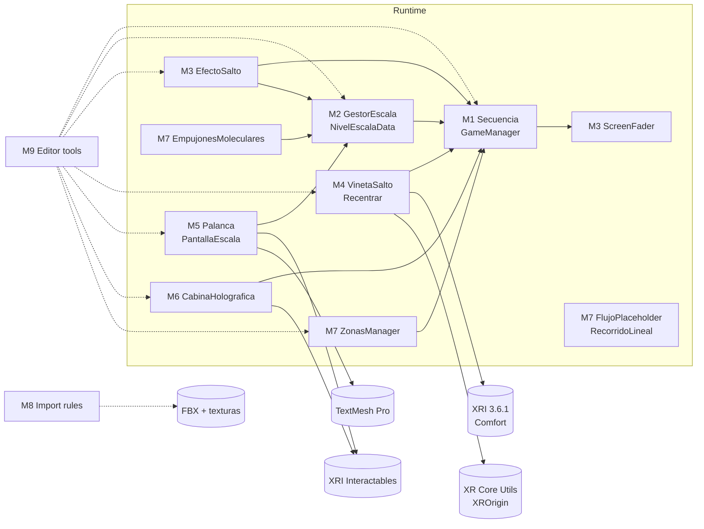
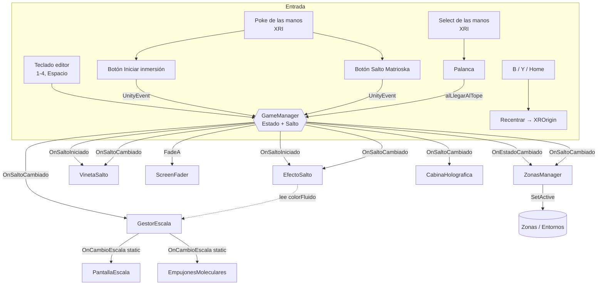
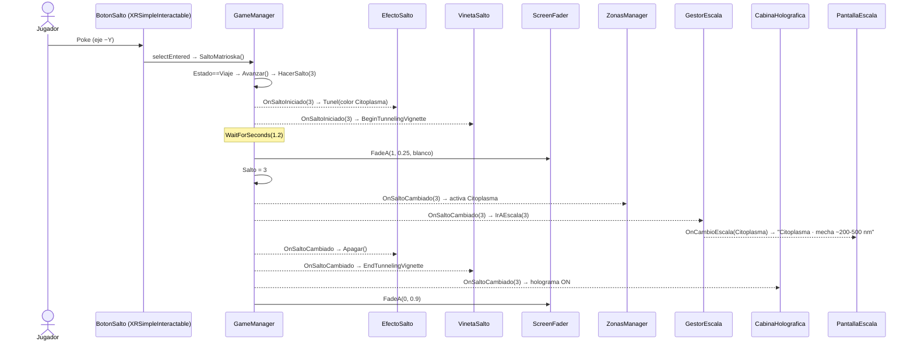

# Desarrollo: arquitectura técnica por módulos

Equipo de Desarrollo · Documento técnico de referencia · Estado al **lunes 12 de octubre de 2026**
Fuente: `main` = `d489fa1` (PR #33) de `github.com/moiseiseiseis/biogamevr`, cruzado con las bitácoras del 8 y 10 de octubre y la Minuta 3.
Primera entrega: **miércoles 14 de octubre** (se presenta lo que se alcanzó).

> **Cómo se relaciona con los otros documentos.** Las bitácoras y la Minuta 3 están organizadas **por rol y por sesión** (quién hizo qué y cuándo). Este documento está organizado **por módulo técnico**: qué sistema es, en qué carpetas vive, qué expone, a quién escucha, cómo fluye la ejecución y qué es todavía *placeholder*. Un módulo puede tener código de varios roles, y un rol puede tocar varios módulos (la tabla de equivalencias está en la §2).

---

## Índice

1. [Línea base de versiones](#1-línea-base-de-versiones)
2. [Mapa de módulos](#2-mapa-de-módulos)
3. [Árbol de carpetas anotado](#3-árbol-de-carpetas-anotado)
4. [Cómo se comunican los módulos](#4-cómo-se-comunican-los-módulos)
5. [Flujo global de ejecución](#5-flujo-global-de-ejecución)
6. [Módulos en detalle (M0 a M10)](#6-módulos-en-detalle)
7. [Flujos por tarea](#7-flujos-por-tarea)
8. [Inventario de placeholders](#8-inventario-de-placeholders)
9. [Convenciones y contratos](#9-convenciones-y-contratos)
10. [Deuda técnica y riesgos conocidos](#10-deuda-técnica-y-riesgos-conocidos)
11. [Checklist técnico para el miércoles](#11-checklist-técnico-para-el-miércoles)

---

## 1. Línea base de versiones

Estas versiones salen de `ProjectSettings/ProjectVersion.txt`, `Packages/manifest.json` y `ProjectSettings/ProjectSettings.asset`. **Nadie las cambia sin pasar por el rol 1.**

| Componente | Versión / valor | Dónde se fija |
| --- | --- | --- |
| Unity Editor | **6000.3.26f1** (`de8167e7440c`), 6.3 LTS | `ProjectSettings/ProjectVersion.txt` |
| Render pipeline | URP `17.3.0` · 2 niveles: `Mobile_RPAsset` (Android) y `PC_RPAsset` (editor) | `Assets/Settings/`, `QualitySettings` |
| XR Interaction Toolkit | `3.6.1` + samples *Starter Assets* y *XR Device Simulator* | `manifest.json`, `Assets/Samples/XR Interaction Toolkit/3.6.1/` |
| OpenXR | `1.18.0` · *Meta Quest Support* · perfiles **Oculus Touch** y **Meta Quest Touch Plus** | `Assets/XR/Settings/OpenXR Package Settings.asset` |
| Input System | `1.20.0` · `activeInputHandler: 1` (solo el nuevo) | `manifest.json`, `ProjectSettings.asset` |
| TextMesh Pro | `com.unity.ugui 2.0.0` + *TMP Essentials* (sin *Examples & Extras*) | `Assets/TextMesh Pro/` |
| Timeline / AI Navigation | `1.8.13` / `2.0.15` (instalados, **sin uso**) | `manifest.json` |
| Color space | Linear (`m_ActiveColorSpace: 1`) | `ProjectSettings.asset` |
| Android | id `com.biogamevr.biovr` · `bundleVersion 0.1.0` · `versionCode 1` · minSdk **32** · targetSdk auto (36) · **IL2CPP** · **ARM64** | `ProjectSettings.asset` |
| Producto | `companyName: BioGameVR` · `productName: BioVR` | `ProjectSettings.asset` |
| Visores objetivo | Quest, Quest 2, Quest Pro, Quest 3, Quest 3S | OpenXR (Meta Quest Support) |
| Escenas en el build | **solo** `Assets/_BioVR/Escenas/00-EscenaInicial.unity` | `EditorBuildSettings.asset` |
| Git | Git LFS obligatorio (FBX, PNG, JPG, PDF, audio, video) · `unityyamlmerge` para YAML | `.gitattributes` |

**Máquina de build (laptop del rol 1):** i5-1235U, 16 GB, Intel Iris Xe (Direct3D 11). No hay GPU dedicada, así que **no hay Quest Link ni Air Link**. Se prueba con el XR Device Simulator en el editor y con el APK directo al visor. También está instalada Unity 6000.6.3f1 sin módulo de Android: **no usarla**.

---

## 2. Mapa de módulos

Los módulos se identifican con **M0 a M10**. `Runtime` = código que va en el APK. `Editor` = herramientas que solo corren dentro de Unity y no entran al build.

| ID | Módulo | Tipo | Namespace | Carpeta(s) | Roles que aportaron | Estado al 12-oct |
| --- | --- | --- | --- | --- | --- | --- |
| **M0** | Plataforma, build y repositorio | Config + Editor | `BioVR.Comun.Editor` | `ProjectSettings/`, `Packages/`, `Assets/Settings/`, `Assets/XR/`, `Comun/Utilidades/Editor/BuildAndroid.cs`, `.gitignore`, `.gitattributes` | 1 | ✅ Estable. APK generado y **sin probar en visor** |
| **M1** | Núcleo de secuencia (máquina de estados + bus de eventos) | Runtime | `BioVR.Secuencia` | `Secuencia/GameManager.cs` | 4 (corregido por 1) | ✅ Funcional en simulador |
| **M2** | Datos de escala | Runtime + datos | `BioVR.Escala` | `Escala/Scripts/NivelEscalaData.cs`, `GestorEscala.cs`, `Escala/Datos/*.asset` | 5 (corregido por 1) | ✅ Funcional · ⚠️ valores provisionales |
| **M3** | Presentación de transiciones (fundido, túnel, destello) | Runtime | `BioVR.Secuencia`, `BioVR.Escala` | `Secuencia/ScreenFader.cs`, `FadeMat.mat`, `Escala/Scripts/EfectoSalto.cs`, `Escala/Materiales/Salto_Particula.mat` | 4, 5 (hecho por 1) | ✅ Funcional en simulador · ⚠️ mareo sin validar |
| **M4** | Rig del jugador y comodidad | Runtime | `BioVR.Jugador` | `Jugador/Scripts/Recentrar.cs`, `VinetaSalto.cs` + XR Origin de Starter Assets | 2 (corregido por 1) | ✅ Funcional · ⚠️ modo de tracking sin decidir |
| **M5** | Interfaz física de cabina (controles) | Runtime | `BioVR.Cabina` | `Cabina/Scripts/Palanca.cs`, `PantallaEscala.cs`, `Cabina/*.prefab`, `Cabina/MaterialsCabin/` | 3 (corregido por 1) | ✅ Funcional en simulador |
| **M6** | Cabina holográfica (modo de render por escala) | Runtime | `BioVR.Escala` | `Escala/Scripts/CabinaHolografica.cs`, `Escala/Materiales/Cabina_Holograma.mat` | 5 (hecho por 1) | ✅ Funcional |
| **M7** | Mundo: zonas y entornos | Runtime | `BioVR.Secuencia`, `BioVR.Entornos`, `BioVR.Escala` | `Secuencia/ZonasManager.cs`, `Entornos/**`, `Escala/Scripts/EmpujonesMoleculares.cs` | 4, 6 (hecho por 1) | 🟡 Vasos y Capilar son placeholder · ⚠️ empujones inactivos (ver §10) |
| **M8** | Pipeline de assets de Diseño | Editor | `BioVR.Modelos.Editor`, `BioVR.Entornos.Editor` | `Modelos/**`, `Modelos/Editor/*.cs`, `Entornos/Editor/PonerModelosDiseno.cs` | 6 (hecho por 1) | ✅ 4 FBX integrados |
| **M9** | Herramientas de ensamblado de escena | Editor | `BioVR.Comun.Editor`, `BioVR.Escala.Editor`, `BioVR.Entornos.Editor` | `Comun/Utilidades/Editor/`, `Escala/Editor/`, `Entornos/Editor/GenerarEntornos.cs` | 1 | ✅ Ya se usaron; la escena está armada |
| **M10** | Depuración, QA y telemetría local | Runtime + proceso | — | Atajos en `GameManager.Update`, prefijos de log, `Escenas/Pruebas/` | 1, 4 | ✅ Simulador · ⬜ visor sin probar |
| — | **Reservados (vacíos)** | — | `BioVR.Comun` | `Comun/Audio/`, `Comun/Materiales/`, `Comun/UI/`, `Minijuegos/`, `Secuencia/AbordajeTrigger` (#26) | — | ⬜ Placeholder de carpeta (`.gitkeep`) |

### Grafo de dependencias (en tiempo de compilación)

Una flecha `A → B` significa que A hace `using` de B o referencia sus tipos.



**Reglas que salen del grafo:**
- **M1 no depende de nadie del juego** (solo de `ScreenFader`, que es su propio módulo de salida). Es la raíz: si M1 compila, todo lo demás puede engancharse.
- **M2 depende de M1**, no al revés. El `GameManager` es la **única fuente de verdad** del índice de escala; `GestorEscala` solo traduce `int → NivelEscalaData`.
- **M7b** (`FlujoPlaceholder`, `RecorridoLineal`) **no depende de nada**. Son animaciones autónomas.
- No hay dependencias circulares. M5 (`PantallaEscala`) escucha a M2 y **no** a M1. Los botones y la palanca de M5 llaman a M1 solo por *UnityEvent* serializado (§4.2), sin `using`.

---

## 3. Árbol de carpetas anotado

### 3.1 Raíz del repo

```
biogamevr/
├── 01-investigacion/         Investigación · mecha-reduccion-escala-v2.pdf (LFS), submarino-y-escala.md, fichas/, referencias/
├── 02-game-design/           Game Design · guia-de-estilo.md, storyboards/, sketches/, cartel-feria/
├── 03-diseno/                Diseño · fuentes/ (.blend) y exports/ (.fbx) — origen de M8
├── 04-desarrollo/
│   ├── README.md             Versiones, estructura y dueños de carpetas
│   └── BioVR/                ← PROYECTO UNITY (abrir ESTA carpeta en Unity Hub)
├── 05-implementacion/        guia-visor-vr.md, plan-de-pruebas.md, reportes-ux/ — consume el APK de M0
├── 06-management/            equipos.md, roadmap.md, reportes-coordinador/
├── docs/                     decisiones.md, minutas/
├── CONTRIBUTING.md           Flujo de ramas, commits y nombres de archivo
├── CREDITOS.md               ⚠️ faltan los créditos de Meshy (escenario celular)
├── .gitignore                Library/, Temp/, Builds/, *.apk, *.slnx, *.zip, /biogamevr/ …
└── .gitattributes            LFS + unityyamlmerge + eol=lf para .cs/.md
```

### 3.2 Proyecto Unity `04-desarrollo/BioVR`

```
BioVR/
├── Assets/
│   ├── _BioVR/                                   ← TODO el código y contenido propio
│   │   ├── Secuencia/                            M1 + M3 + M7
│   │   │   ├── GameManager.cs                    M1  máquina de estados y bus de eventos
│   │   │   ├── ScreenFader.cs                    M3  fundido a color con un quad
│   │   │   ├── ZonasManager.cs                   M7  activa la zona según (estado, salto)
│   │   │   └── FadeMat.mat                       M3  material del quad "Fundido"
│   │   ├── Escala/                               M2 + M3 + M6 + M7
│   │   │   ├── Scripts/
│   │   │   │   ├── NivelEscalaData.cs            M2  ScriptableObject (menú Create → BioVR/Nivel de Escala Data)
│   │   │   │   ├── GestorEscala.cs               M2  int → NivelEscalaData, evento estático
│   │   │   │   ├── EfectoSalto.cs                M3  túnel de partículas
│   │   │   │   ├── CabinaHolografica.cs          M6  swap de materiales / ocultar piezas
│   │   │   │   └── EmpujonesMoleculares.cs       M7  ruido Perlin sobre hijos
│   │   │   ├── Datos/Escala{0..3}_*.asset        M2  los 4 niveles (valores provisionales)
│   │   │   ├── Materiales/                       Cabina_Holograma.mat, Salto_Particula.mat
│   │   │   └── Editor/                           M9  AgregarEfectoSalto.cs, AgregarCabinaHolografica.cs
│   │   ├── Jugador/Scripts/                      M4  Recentrar.cs, VinetaSalto.cs
│   │   ├── Cabina/                               M5
│   │   │   ├── Scripts/Palanca.cs, PantallaEscala.cs
│   │   │   ├── BotonInicio.prefab, BotonSalto.prefab   botones con etiqueta TMP (Canvas world-space)
│   │   │   ├── Button1.prefab                    botón base (de aquí salen los otros dos)
│   │   │   ├── Lever1.prefab                     base / pivote(Palanca + XRSimpleInteractable) / handle / joystick
│   │   │   ├── PantallaEscala.prefab             Canvas + TextoNivel (TMP)
│   │   │   └── MaterialsCabin/                   ButtonState1/2, color_cabina, Azul1, MetalShine, morado
│   │   ├── Entornos/                             M7 (+ M8/M9 en Editor/)
│   │   │   ├── Hangar/Hangar.prefab              Sala, Luces, Submarino (capsulas)[OFF], Modelo Nave Seraphim, Modelo Explorador
│   │   │   ├── VasoSanguineo/VasoSanguineo.prefab   100% placeholder · Globulos (flujo)
│   │   │   ├── Capilar/Capilar.prefab            100% placeholder · Proteinas (flujo)
│   │   │   ├── EspacioCelular/EspacioCelular.prefab Modelo Escenario celular + placeholders [OFF]
│   │   │   ├── Scripts/FlujoPlaceholder.cs, RecorridoLineal.cs
│   │   │   ├── Materiales/                       28 materiales placeholder (Capilar_*, Celula_*, Fondo_*, Hangar_*, Submarino_*, Vaso_*)
│   │   │   └── Editor/GenerarEntornos.cs, PonerModelosDiseno.cs
│   │   ├── Modelos/                              M8 (FBX en LFS)
│   │   │   ├── Cabina/submarino-cabina.fbx
│   │   │   ├── NaveExterior/submarino-exterior.fbx
│   │   │   ├── EscenarioCelular/escenario-celular.fbx + texturas/ (41 archivos, ~347 k triángulos)
│   │   │   ├── Explorador/explorador_caricatura.fbx
│   │   │   └── Editor/ImportarModelosDiseno.cs (AssetPostprocessor), RevisarModelos.cs
│   │   ├── Comun/
│   │   │   ├── Utilidades/Editor/                M0 + M9  BuildAndroid.cs, ArmarEscenaInicial.cs, IntegrarControlesCabina.cs
│   │   │   ├── Audio/  Materiales/  UI/          ⬜ reservados (.gitkeep)
│   │   ├── Minijuegos/                           ⬜ reservado (después de la 1.ª entrega)
│   │   └── Escenas/
│   │       ├── 00-EscenaInicial.unity            ← ÚNICA escena del build (solo la edita el rol 1)
│   │       └── Pruebas/                          M10  Rol2_JugadorSentado, Rol3_BotonCabina, Rol3_PalancaCabina, Rol4_Secuencia
│   ├── Samples/XR Interaction Toolkit/3.6.1/     Starter Assets (XR Origin, TunnelingVignette, poke) + XR Device Simulator · NO EDITAR
│   ├── Settings/                                 URP: Mobile_RPAsset/Renderer (Android), PC_RPAsset/Renderer (editor) · NO EDITAR sin rol 1
│   ├── XR/                                       OpenXR loaders y settings (autogenerado)
│   ├── XRI/                                      ajustes XRI y del simulador (autogenerado)
│   ├── TextMesh Pro/                             Essentials
│   └── InputSystem_Actions.inputactions          de la plantilla (no lo usa ningún script propio)
├── Packages/manifest.json                        M0
├── ProjectSettings/                              M0
└── Builds/BioVR.apk                              M0 · salida del build (gitignored, ~82 MB, Development)
```

### 3.3 Jerarquía de `00-EscenaInicial.unity` (como está en `main`)

```
XR Origin (XR Rig)                    [prefab Starter Assets]  M4
 ├ + Recentrar                        M4  (xrOrigin, puntoOjos → Cabina/Punto ojos)
 ├ + VinetaSalto                      M4  (controlador → TunnelingVignette)
 ├ Locomotion: Turn, Move, Grab Move, Teleportation, Climb, Gravity, Jump  [OFF]
 ├ Left/Right Controller → Poke Interactor (hápticos de XRI), Teleport Interactor [OFF]
 └ Camera Offset / Main Camera
     ├ Fundido                        M3  quad a 0.3 m, FadeMat, renderer apagado en reposo
     └ TunnelingVignette              M4  [prefab Starter Assets] TunnelingVignetteController

Cabina (provisional)                  M5 + M6  + CabinaHolografica
 ├ piso_cabina, pared_*, techo, tablero_frontal, Consola (provisional),
 │ Asiento (provisional), Base palanca                         [OFF] (los sustituye el modelo)
 ├ Punto ojos                         (0, 1.2, 0) local
 ├ Modelo Cabina de Diseño            [FBX] ANCLA_Jugador alineada a (0, *, 0); INT_* ocultos
 ├ Boton Iniciar inmersion            [BotonInicio.prefab] → GameManager.IniciarInmersion  (sobre INT_Boton_Anclaje)
 ├ Boton Salto Matrioska              [BotonSalto.prefab]  → GameManager.SaltoMatrioska    (sobre INT_Boton_Escala)
 ├ Palanca                            [Lever1.prefab] alLlegarAlTope → SaltoMatrioska       (sobre INT_Palanca_Potencia)
 └ Pantalla de escala                 [PantallaEscala.prefab] 2 cm delante de INT_Pantalla_Principal

Secuencia                             M1 + M2 + M3 + M7
 └ GameManager · ScreenFader · ZonasManager · GestorEscala(nivelesEscala[4])

EfectoSalto                           M3  ParticleSystem (anillo r 2.5–4.2 m, 60 m al frente) + EfectoSalto

Zonas                                 M7
 ├ Hangar      (estado Hangar,   salto -1) → Entorno Hangar
 ├ Abordaje    (estado Abordaje, salto -1) → Entorno Hangar  (otra instancia)
 ├ Vasos       (estado Viaje,    salto 1)  → Entorno VasoSanguineo
 ├ Capilar     (estado Viaje,    salto 2)  → Entorno Capilar
 ├ Citoplasma  (estado Viaje,    salto 3)  → Entorno EspacioCelular
 └ Llegada     (estado Llegada,  salto -1) → Entorno EspacioCelular  (otra instancia)
   (cada zona trae además la figura primitiva del rol 4 a z = 6 m)

Directional Light
Piso (provisional)                    [OFF]
```

---

## 4. Cómo se comunican los módulos

En el proyecto hay **cuatro mecanismos** de comunicación. Saber cuál usa cada conexión es lo que permite depurar.

| # | Mecanismo | Dónde se define | Se conecta en | Ejemplo |
| --- | --- | --- | --- | --- |
| 1 | **Eventos C# de instancia** (`event Action<T>`) en el singleton `GameManager.Instance` | Código | `Start()` del suscriptor (`+=`), se desconecta en `OnDestroy()` (`-=`) | `OnSaltoCambiado` → `GestorEscala.IrAEscala` |
| 2 | **Evento C# estático** `GestorEscala.OnCambioEscala` | Código | `Start()` / `OnDestroy()` del suscriptor | → `PantallaEscala`, `EmpujonesMoleculares` |
| 3 | **UnityEvents persistentes** (serializados en la escena) | YAML de `00-EscenaInicial.unity` | Las herramientas de M9 los escriben con `UnityEventTools.AddVoidPersistentListener` | `XRSimpleInteractable.selectEntered` → `GameManager.IniciarInmersion()` |
| 4 | **Referencias serializadas** (`[SerializeField]`) y búsquedas | Inspector / M9 | Carga de escena; `FindFirstObjectByType<GestorEscala>()` | `GameManager.fader`, `EfectoSalto.gestorEscala`, `VinetaSalto.controlador` |

Además entra **input** por dos vías independientes: **XRI** (Poke y Select de las manos sobre los interactables) y **Input System directo** (`Recentrar`: B/Y/Home; `GameManager.Update`: teclado de depuración).

### 4.1 Tabla de eventos (el bus)

| Evento | Publicador | Firma | Cuándo se dispara | Suscriptores (módulo) |
| --- | --- | --- | --- | --- |
| `OnEstadoCambiado` | `GameManager` (M1) | `Action<GameState>` | En `Transicion()`, con la pantalla **ya cubierta** | `ZonasManager` (M7) |
| `OnSaltoIniciado` | `GameManager` (M1) | `Action<int>` (índice destino) | Al **inicio** de `Cubrir()` si es salto, antes del túnel | `EfectoSalto` (M3) arranca partículas · `VinetaSalto` (M4) cierra viñeta |
| `OnSaltoCambiado` | `GameManager` (M1) | `Action<int>` (índice nuevo) | Con la pantalla cubierta, **después** de `OnEstadoCambiado` (en `Transicion`) o solo (en `HacerSalto`) | `ZonasManager` (M7) · `GestorEscala` (M2) · `EfectoSalto` (M3) limpia · `VinetaSalto` (M4) abre · `CabinaHolografica` (M6) |
| `OnCambioEscala` *(static)* | `GestorEscala` (M2) | `Action<NivelEscalaData>` | Dentro de `IrAEscala()`, que a su vez corre dentro de `OnSaltoCambiado` | `PantallaEscala` (M5) · `EmpujonesMoleculares` (M7) |
| `Palanca.alLlegarAlTope` | `Palanca` (M5) | `UnityEvent` | Al pasar `anguloMax − margen` (42°), una vez hasta rearmar (< 35°) | `GameManager.SaltoMatrioska()` (persistente) |
| `selectEntered` (Botón Inicio) | `XRSimpleInteractable` (M5) | `UnityEvent<SelectEnterEventArgs>` | Poke válido (XRPokeFilter, eje −Y, umbral 45°) | `GameManager.IniciarInmersion()` + material `ButtonState2` + sonido |
| `selectEntered` (Botón Salto) | `XRSimpleInteractable` (M5) | ídem | ídem | `GameManager.SaltoMatrioska()` + material + sonido |
| `selectExited` (botones) | `XRSimpleInteractable` (M5) | ídem | Al soltar | Material `ButtonState1` |
| `Recentrar` (InputAction) | Input System (M4) | `performed` | B/Y (`<XRController>{Right/LeftHand}/secondaryButton`) o `Home` | `Recentrar.AlPresionarBoton` |

### 4.2 Orden de llamadas dentro de un mismo frame

`Transicion()` invoca primero `OnEstadoCambiado` y luego `OnSaltoCambiado`. Dentro de `OnSaltoCambiado` el orden de los suscriptores es **el orden en que se suscribieron**, que depende del orden de `Start()`, y Unity no lo garantiza. Hoy **ningún suscriptor depende de otro dentro del mismo evento**, así que el orden no importa. **Regla:** no agregar lógica que suponga que `GestorEscala` ya procesó el salto cuando otro suscriptor de `OnSaltoCambiado` se ejecuta. Si hace falta el nivel nuevo, hay que escuchar `OnCambioEscala`.

### 4.3 El problema del primer evento (arranque)

`GameManager.Start()` llama `IrA(estadoInicial, instantaneo: true)`. Como es instantáneo, la corrutina **no llega a ningún `yield`** y dispara `OnEstadoCambiado` y `OnSaltoCambiado` **dentro del mismo `Start()`**, quizá antes de que los demás se suscriban. Por eso **todos los suscriptores leen el estado actual al suscribirse**:

| Suscriptor | Cómo se sincroniza al arrancar |
| --- | --- |
| `ZonasManager` | `Aplicar()` al final de `Start()` |
| `GestorEscala` | `IrAEscala(gm.Salto)` |
| `CabinaHolografica` | `AlCambiarSalto(gm.Salto)` |
| `EfectoSalto` | `Apagar()` |
| `PantallaEscala` | `FindFirstObjectByType<GestorEscala>().EscalaActual` |
| `EmpujonesMoleculares` | ídem, lee `intensidadEmpujones` |
| `VinetaSalto` | no lo necesita (la viñeta empieza abierta) |

**Contrato para módulos nuevos:** quien se suscriba a M1 o a M2 **debe** leer el estado actual en su `Start()` y desuscribirse en `OnDestroy()`.

### 4.4 Diagrama de comunicación



---

## 5. Flujo global de ejecución

### 5.1 Máquina de estados (M1)

```mermaid
stateDiagram-v2
  [*] --> Hangar: Start() instantáneo · Salto=0
  Hangar --> Abordaje: Avanzar / IniciarInmersion · fundido negro
  Abordaje --> Viaje: Avanzar / IniciarInmersion · SALTO 0→1
  state Viaje {
    Vasos --> Capilar: SaltoMatrioska · SALTO 1→2
    Capilar --> Citoplasma: SaltoMatrioska · SALTO 2→3
  }
  Viaje --> Llegada: SaltoMatrioska con Salto=3 · fundido negro
  Llegada --> [*]: (sin salida; solo teclas 1-4 en editor)
```

| `GameState` | `Salto` | Zona activa | Nivel M2 | Cabina (M6) | Controles válidos |
| --- | --- | --- | --- | --- | --- |
| `Hangar` | 0 | Hangar | `Escala0_Hangar` | física | Iniciar inmersión |
| `Abordaje` | 0 | Abordaje (mismo prefab Hangar) | `Escala0_Hangar` | física | Iniciar inmersión |
| `Viaje` | 1 | Vasos | `Escala1_Vasos` | física | Salto Matrioska, palanca |
| `Viaje` | 2 | Capilar | `Escala2_Capilar` | física | Salto Matrioska, palanca |
| `Viaje` | 3 | Citoplasma | `Escala3_Citoplasma` | **holográfica** | Salto Matrioska, palanca |
| `Llegada` | 3 | Llegada (mismo prefab EspacioCelular) | `Escala3_Citoplasma` | **holográfica** | ninguno |

`SaltoDeEstado()`: `Viaje → 1`, `Llegada → SaltoMaximo (3)`, cualquier otro → 0. Una transición **es salto** si `!instantaneo && saltoNuevo > Salto`. Por eso **Abordaje → Viaje** es un salto (0 → 1) y **Viaje(3) → Llegada** no lo es (3 → 3, fundido negro).

### 5.2 Línea de tiempo de un salto (valores actuales del Inspector)

```
t (s)  0.00          1.20     1.45                         2.35
       │─────────────│────────│────────────────────────────│
GM     OnSaltoIniciado         Salto=n, OnSaltoCambiado      enTransicion=false
                     WaitForSeconds(1.2)
Fader                FadeA(1, 0.25, blanco)  FadeA(0, 0.9)   (fadeTime 0.6 × 1.5)
Efecto Play() ── emisión 0→400/s, simSpeed 0.4→2.5 (k²) ──┤ Apagar() (Clear)
Viñeta Begin (easeIn 0.4) ─────────────────────────────────┤ End (easeOut 0.4)
Zonas                                   SetActive(nueva)
Cabina                                  holograma si n ≥ 3
Pantalla                                texto nuevo (vía OnCambioEscala)
```

- Un **cambio de estado sin salto** (Hangar → Abordaje, Viaje → Llegada, teclas de depuración hacia atrás) dura `0.6 s` en negro + `0.6 s` para destapar = **1.2 s**.
- ⚠️ `EfectoSalto.duracion = 1.45` está **copiado a mano** de `duracionEfectoSalto + duracionDestello`. Si se cambia uno en el `GameManager`, hay que cambiar el otro (ver §10).
- Mientras `enTransicion == true`, `Avanzar()` e `IrA()` **se ignoran** y escriben `[Secuencia] … ignorado`. Esto evita los dobles saltos al presionar dos veces.

### 5.3 Diagrama de secuencia: el jugador presiona «Salto Matrioska» en Capilar



---

## 6. Módulos en detalle

Cada módulo tiene el mismo formato: **responsabilidad · archivos · API pública · parámetros · dependencias · placeholders · pendientes**.

### M0. Plataforma, build y repositorio

**Responsabilidad:** que el proyecto abra igual en todas las computadoras y que salga un APK instalable en Quest.

**Archivos:** `ProjectSettings/*`, `Packages/manifest.json`, `Assets/Settings/*` (URP), `Assets/XR/*` (OpenXR), `Comun/Utilidades/Editor/BuildAndroid.cs`, `.gitignore`, `.gitattributes`.

**API:**
| Punto de entrada | Qué hace |
| --- | --- |
| Menú `BioVR → Build APK` | `BuildPipeline.BuildPlayer` con las escenas activas de Build Settings → `Builds/BioVR.apk`, *Development build* |
| `-executeMethod BioVR.Comun.Editor.BuildAndroid.Construir` | Lo mismo en batch: `Unity.exe -batchmode -quit -projectPath 04-desarrollo/BioVR -buildTarget Android -executeMethod …` (**Unity debe estar cerrado**) |

**Configuración clave que no se toca:**
- `Mobile_RPAsset.asset` es el nivel de calidad de Android (`QualitySettings: Android → 0`). Si se borra, el visor muestra materiales rosas o pantalla negra (ya pasó una vez en la rama del rol 2).
- OpenXR Android: Meta Quest Support con Oculus Touch y Touch Plus; *Optimize Buffer Discards* ON. Foveated rendering y Spacewarp están **disponibles pero sin configurar** (candidatos si el rendimiento no alcanza, §10).
- XR Device Simulator activado solo en el editor (*Project Settings → XR Interaction Toolkit*).

**Métricas del último build:** 4.9 min, 0 errores, 82 MB. Única advertencia: SSAO en `PC_Renderer`, que no aplica en Android.

**Placeholders:** `bundleVersion 0.1.0` / `versionCode 1` (no se ha versionado ningún build). El build es *Development*, no *Release*. No hay ícono ni splash propios.

**Pendientes:** probar en el visor (#28). Decidir si el APK del miércoles es *Development* (permite `adb logcat`) o *Release*. Subir `versionCode` en cada APK que se entregue.

---

### M1. Núcleo de secuencia

**Responsabilidad:** decidir *en qué momento del juego estamos* y avisar a todos. Es el único módulo que muta `Estado` y `Salto`.

**Archivo:** `Secuencia/GameManager.cs` · `namespace BioVR.Secuencia` · objeto `Secuencia` de la escena.

**API pública:**
| Miembro | Tipo | Uso |
| --- | --- | --- |
| `Instance` | `static GameManager` | Singleton. Si hay un segundo, se desactiva y escribe `LogError` |
| `Estado` | `GameState { Hangar, Abordaje, Viaje, Llegada }` | Solo lectura |
| `Salto` | `int` 0..3 | Solo lectura. **Fuente de verdad del índice de escala** |
| `SaltoMaximo` | `const int = 3` | |
| `Avanzar()` | método | Avance genérico (teclado y depuración) |
| `IniciarInmersion()` | método | Solo actúa en Hangar o Abordaje. Lo usa el botón Inicio |
| `SaltoMatrioska()` | método | Solo actúa en Viaje. Lo usan el botón Salto y la palanca |
| `IrA(GameState, bool instantaneo=false)` | método | Salto directo a un estado (depuración) |
| `OnEstadoCambiado`, `OnSaltoIniciado`, `OnSaltoCambiado` | eventos | §4.1 |

**Parámetros (Inspector):** `fader`, `fadeTime = 0.6`, `estadoInicial = Hangar`, `duracionEfectoSalto = 1.2`, `duracionDestello = 0.25`, `colorDestello = blanco`.

**Invariantes:**
- Solo hay una transición a la vez (`enTransicion`).
- `Estado` y `Salto` solo cambian con la pantalla cubierta (`alpha = 1`), salvo el arranque instantáneo.
- Si `fader == null`, la secuencia funciona sin fundidos (degradación controlada).

**Placeholders:** `Abordaje` es un estado **sin contenido propio**: muestra el mismo prefab Hangar. Ahí iría la animación o el trigger de abordaje (`AbordajeTrigger`, #26, que nunca se subió). `Llegada` es un estado terminal sin salida ni evento de fin.

**Pendientes:** decidir qué pasa en `Abordaje` (#26). Evento o UI de fin de recorrido en `Llegada`. Reinicio para la feria (volver a Hangar sin teclado; hoy solo existe `IrA(Hangar)` con la tecla 1 en el editor).

---

### M2. Datos de escala

**Responsabilidad:** traducir el índice `Salto` a parámetros del nivel (nombre, tamaño, física, color) y difundirlos.

**Archivos:** `Escala/Scripts/NivelEscalaData.cs` (ScriptableObject), `GestorEscala.cs` (en `Secuencia`), `Escala/Datos/Escala{0..3}_*.asset`.

**Esquema `NivelEscalaData`:**
| Campo | Tipo | Rango | Lo consume hoy |
| --- | --- | --- | --- |
| `nombreNivel` | string | — | `PantallaEscala` |
| `tamanoMecha` | string | — | `PantallaEscala` |
| `inercia` | float | 0..1 | **nadie** (solo log) |
| `viscosidad` | float | 0..10 | **nadie** (solo log) |
| `intensidadEmpujones` | float | ≥ 0 | `EmpujonesMoleculares` (⚠️ inactivo, §10) |
| `colorFluido` | Color | — | `EfectoSalto` (color de las rayas, aclarado 35 %) |

**Datos actuales (provisionales, falta que Investigación los confirme):**
| Índice | Asset | `nombreNivel` | `tamanoMecha` | inercia | viscosidad | empujones | colorFluido (RGBA) |
| --- | --- | --- | --- | --- | --- | --- | --- |
| 0 | `Escala0_Hangar` | Hangar | Tamaño real | 1 | 0 | 0 | (0, 0, 0, 0) → rayas blancas |
| 1 | `Escala1_Vasos` | Vasos sanguíneos | ~1-5 mm | 0.8 | 1 | 0.2 | (0.55, 0.05, 0.08, 1) |
| 2 | `Escala2_Capilar` | Capilar | ~1 µm | 0.4 | 4 | 0.4 | (0.75, 0.30, 0.35, 1) |
| 3 | `Escala3_Citoplasma` | Citoplasma | ~200-500 nm | 0 | 8 | 1 | (0.85, 0.80, 0.55, 1) |

**API `GestorEscala`:** `nivelesEscala[]` (público, orden = índice), `EscalaActual`, `IrAEscala(int)` (público; valida rango y escribe un warning si no existe el nivel), `static event OnCambioEscala`.

**Placeholders:** `inercia` y `viscosidad` existen como dato pero **no tienen comportamiento**. No hay campo `textoEscala` (proporción "1 : 1 000") ni audio por nivel.

**Pendientes:** confirmar valores con Investigación. Decidir si `inercia`/`viscosidad` afectan algo visible (velocidad de `FlujoPlaceholder`, amortiguación de la palanca, *drag* de partículas) o se quitan del esquema.

---

### M3. Presentación de transiciones

**Responsabilidad:** tapar la vista mientras M1 cambia el mundo y hacer que el salto se *sienta* como salto.

| Componente | Archivo | Objeto en escena | Qué hace |
| --- | --- | --- | --- |
| `ScreenFader` | `Secuencia/ScreenFader.cs` | `Secuencia` (ref. al quad `Main Camera/Fundido`) | `FadeA(alpha, duración, Color?)`. Lerp de alpha con `Time.unscaledDeltaTime`. Prende el renderer al empezar y lo apaga al llegar a 0 |
| `FadeMat` | `Secuencia/FadeMat.mat` | quad `Fundido` | Unlit transparente. El script instancia el material (`quad.material`) |
| `EfectoSalto` | `Escala/Scripts/EfectoSalto.cs` | `EfectoSalto` | En `OnSaltoIniciado`: color del nivel destino; la emisión sube 0 → `emisionMaxima` (400/s) y `simulationSpeed` va de 0.4 a 2.5 (curva k²). En `OnSaltoCambiado`: `Stop(StopEmittingAndClear)` |
| ParticleSystem | creado por `AgregarEfectoSalto.cs` | `EfectoSalto` | Anillo de radio 2.5–4.2 m a 60 m al frente; rayas hacia −Z. Material `Salto_Particula` |

**Contrato con M4:** la viñeta (M4) usa los mismos eventos, así que la comodidad y el efecto visual siempre están sincronizados.

**Placeholders:** el salto es **solo visual**. No hay audio, ni hápticos dedicados, ni la *separación de módulos del mecha* del Protocolo Matrioska (espera el modelo de Diseño con piezas separables).

**Pendientes:** validar el mareo en el visor. Sonido de salto (cuando exista `Comun/Audio/`). Hápticos en los dos mandos durante el túnel.

---

### M4. Rig del jugador y comodidad

**Responsabilidad:** el jugador va **sentado**, ve desde el asiento del piloto, puede recentrar y no se marea.

**Base:** `XR Origin (XR Rig)` de Starter Assets 3.6.1 con **toda la locomoción apagada** (Turn, Move, Grab Move, Teleportation, Climb, Gravity, Jump y los dos Teleport Interactor). Se conservan Poke Interactor y Near-Far Interactor de cada mano, porque son los que presionan y agarran.

| Componente | Archivo | API / parámetros |
| --- | --- | --- |
| `Recentrar` | `Jugador/Scripts/Recentrar.cs` | `xrOrigin`, `puntoOjos` (= `Cabina/Punto ojos`, (0, 1.2, 0)). Acción por defecto: `<XRController>{RightHand}/secondaryButton`, `{LeftHand}/secondaryButton`, `<Keyboard>/home`. Llama `MoveCameraToWorldLocation(puntoOjos)` + `MatchOriginUpCameraForward(up, +Z)` |
| `VinetaSalto` | `Jugador/Scripts/VinetaSalto.cs` | Implementa `ITunnelingVignetteProvider`. `apertureSize 0.55`, `feathering 0.25`, `easeIn/Out 0.4`, negro. `Begin` en `OnSaltoIniciado` y `End` en `OnSaltoCambiado` |
| `TunnelingVignette` | prefab de Starter Assets | Hijo de Main Camera. Sin un *provider* activo se queda abierto: por eso no basta con prender el objeto |

**Convención espacial:** la cabina está en el origen del mundo y el frente es **+Z**. La cámara **nunca** se mueve por código salvo en `Recentrar`. Lo que se mueve siempre es el exterior.

**Placeholders / sin decidir:** el modo de tracking sigue en *Floor* (`CameraYOffset 1.1176`, que en Floor se ignora). La altura real de los ojos depende de recentrar.

**Pendientes:** probar en el visor si hace falta forzar `Device` + offset o un recentrado automático al arrancar. Manos con los guantes del traje del explorador (opcional).

---

### M5. Interfaz física de cabina

**Responsabilidad:** los controles con los que el jugador maneja la secuencia.

| Control | Prefab | Componentes | Disparo | Acción en M1 |
| --- | --- | --- | --- | --- |
| Botón **Iniciar inmersión** | `Cabina/BotonInicio.prefab` | `XRSimpleInteractable` + `XRPokeFilter` (−Y, 45°) + `BoxCollider` 6 × 2 × 6 cm + `AudioSource` ("Button Pop") + Canvas/TMP | `selectEntered` | `IniciarInmersion()` |
| Botón **Salto Matrioska** | `Cabina/BotonSalto.prefab` | ídem | `selectEntered` | `SaltoMatrioska()` |
| **Palanca** | `Cabina/Lever1.prefab` → `pivote` con `Palanca` + `XRSimpleInteractable` | Sin física (no HingeJoint ni Rigidbody) | `alLlegarAlTope` (≥ 42°) | `SaltoMatrioska()` |
| **Pantalla de escala** | `Cabina/PantallaEscala.prefab` | Canvas world-space + `TextoNivel` (TMP) + `PantallaEscala` | `OnCambioEscala` | — (solo muestra) |
| Botón base | `Cabina/Button1.prefab` | Plantilla de los dos botones | — | — |

**Algoritmo de `Palanca`:** al agarrar guarda `zAlAgarrar` (Z de la mano en el espacio local de la base) y `anguloAlAgarrar`. Cada frame calcula `ángulo = anguloAlAgarrar + (z − zAlAgarrar) / radio · Rad2Deg` y lo limita a `[anguloMin = 0, anguloMax = 45]`. Al soltar regresa a 0 a 120°/s. El evento se rearma cuando el ángulo baja de `45 − rearmar (10) = 35°`. Parámetros: `margen 3`, `radio 0.25 m`.

**Estados visuales del botón:** `ButtonState1.mat` (reposo) y `ButtonState2.mat` (presionado). Lo cambian los UnityEvents del prefab, sin script propio.

**Hápticos:** los da el `Poke Interactor` del XR Rig (están en la mano, no en el botón).

**Colocación:** las herramientas de M9 y M8 los ponen **encima** de las piezas `INT_*` del modelo de Diseño (§9.3) y ocultan esas piezas.

**Placeholders:** los controles decorativos del modelo de Diseño (selector y tapa de escala, interruptor de luces, escotilla, pantallas laterales) **no tienen función**. La pantalla solo muestra texto, sin la proporción ni una animación de transición.

**Pendientes:** dar función a los controles decorativos (opcional). Confirmar con Game Design los nombres y colores. Verificar en el visor que los controles se alcanzan desde el asiento.

---

### M6. Cabina holográfica

**Responsabilidad:** Protocolo Matrioska. Desde la escala celular la cabina deja de ser física y se ve como una reconstrucción.

**Archivo:** `Escala/Scripts/CabinaHolografica.cs` en `Cabina (provisional)`. Material `Escala/Materiales/Cabina_Holograma.mat` (cian semitransparente con emisión).

**Lógica:**
1. En `Start()` recorre todos los `Renderer` hijos y **excluye** los que estén bajo un `XRBaseInteractable` (botones y palanca conservan su color).
2. Los renderers cuyo nombre **empieza** con `CAB_Estructura`, `CAB_Cristal` o `CAB_Mobiliario` van a la lista `ocultos`. Los demás guardan sus `sharedMaterials` originales.
3. En `OnSaltoCambiado(salto)`: si `salto ≥ saltoHolograma (3)`, apaga los `ocultos` y pone `holograma` en todos los slots del resto. Si no, restaura.

**Dependencia de nombres:** depende de los prefijos `CAB_*` del FBX de Diseño. Si Diseño los renombra, el modo holográfico deja de ocultar paredes **sin dar error**.

**Pendientes:** ninguno bloqueante. Opcional: transición animada (hoy es un cambio instantáneo bajo el destello).

---

### M7. Mundo: zonas y entornos

**Responsabilidad:** qué se ve fuera de la cabina en cada momento y cómo se anima.

**`ZonasManager`** (`Secuencia/ZonasManager.cs`): arreglo `Zona { GameObject objeto; GameState estado; int salto = -1 }`. Regla: `activo = (estado == gm.Estado) && (salto < 0 || salto == gm.Salto)`. Se reaplica en cada `OnEstadoCambiado` y `OnSaltoCambiado`.

**Prefabs de entorno** (`Entornos/<Nombre>/<Nombre>.prefab`):
| Prefab | Zonas | Contenido real | Contenido placeholder | Animación |
| --- | --- | --- | --- | --- |
| `Hangar` | Hangar, Abordaje | **Modelo Nave Seraphim** (`submarino-exterior.fbx`, z = 17 m) · **Modelo Explorador** (traje de la tripulación, (−2.5, 0, 6), rot 180°) | Sala (piso, paredes, franjas), Luces · `Submarino (capsulas)` [OFF] | — |
| `VasoSanguineo` | Vasos (salto 1) | — | **Todo:** pared del vaso, glóbulos rojos, leucocitos, fondo | `FlujoPlaceholder` en `Globulos (flujo)`: −Z, pulsos de 1.2 Hz |
| `Capilar` | Capilar (salto 2) | — | **Todo:** pared, proteínas, anticuerpos, fondo | `FlujoPlaceholder` en `Proteinas (flujo)`: lento, sin pulso |
| `EspacioCelular` | Citoplasma (3), Llegada | **Modelo Escenario celular** (`escenario-celular.fbx`, ~500 m, ~347 k triángulos) | Fondo, Membrana, Citoesqueleto, Ribosomas y enzimas, Golgi, Mitocondrias, Cinesina con vesícula: **todos [OFF]** | ⚠️ ninguna activa (ver §10) |

**Scripts de animación:**
| Script | Parámetros | Notas |
| --- | --- | --- |
| `FlujoPlaceholder` | `velocidad 3 m/s`, `pulso 1.5`, `frecuencia 1.2 Hz`, `giro 20°/s`, `zMin −10`, `zMax 70` | Mueve todos los hijos hacia −Z y los recicla al pasar `zMin`. Latido = `max(0, sin(2πft))` |
| `RecorridoLineal` | `inicio`, `fin`, `velocidad 1`, `balanceo 8°` | Cinesina sobre un microtúbulo (hoy en un grupo apagado) |
| `EmpujonesMoleculares` | `amplitud 0.25 m`, `frecuencia 0.8` | Ruido Perlin 3D por hijo × `intensidadEmpujones` (escucha `OnCambioEscala`) |

**Regla anti-mareo:** el exterior se mueve; la cabina y la cámara **nunca**.

**Placeholders:** Vasos y Capilar completos. El cuarto del hangar. Todos los materiales `Entornos/Materiales/*` son colores provisionales, sin texturas. Sin colliders ni sombras.

**Pendientes:** reactivar el movimiento en el citoplasma (§10). Preguntar a Diseño si habrá modelos de vaso, capilar y hangar. Medir en el visor el costo de tener **dos instancias** de `EspacioCelular` (Citoplasma y Llegada) en memoria.

---

### M8. Pipeline de assets de Diseño

**Responsabilidad:** que los FBX de Diseño entren al juego con ajustes uniformes, sin tocar el Inspector a mano y sin modificar los archivos de Diseño.

**Flujo de entrada:** `03-diseno/exports/*.fbx` (rama de Diseño + PR) → el rol 1 copia a `Assets/_BioVR/Modelos/<Categoria>/` → `ImportarModelosDiseno` (AssetPostprocessor) → `RevisarModelos` (auditoría) → `PonerModelosDiseno` (colocación).

**`ImportarModelosDiseno`** (`GetVersion() = 5`; se sube cuando cambian las reglas para forzar la reimportación):
| Hook | Reglas |
| --- | --- |
| `OnPreprocessModel` | `useFileScale` (cm/m → m), sin cámaras, luces, animación ni colliders; `ImportViaMaterialDescription`; `materialSearch = Everywhere` |
| `OnPreprocessMaterialDescription` | Busca por **nombre de archivo** (en `Modelos/`) las texturas `DiffuseColor → _BaseMap`, `NormalMap → _BumpMap`, `EmissiveColor → _EmissionMap`. Emisión con textura = 0.4; sin textura se limita a 0.6 manteniendo el tono; si es gris o blanca y sin textura, se quita. Pone `RealtimeEmissive` |
| `OnPreprocessTexture` | `*normal*` → NormalMap; `*metallic*`/`*roughness*` → lineal; Android: máximo 1024 px, **ASTC 6×6** |

**`RevisarModelos`:** menús `Revisar modelos de Diseño` (tamaño en m, triángulos totales y de LOD0, materiales, posición de `ANCLA_Jugador` e `INT_*`) y `Revisar materiales del escenario celular`.

**`PonerModelosDiseno`:** instancia cada FBX con el prefijo **`"Modelo "`** (constante `PrefijoModelo`) y apaga los placeholders equivalentes **sin borrarlos**. Alinea `ANCLA_Jugador` al origen. Pone los controles de M5 encima de las piezas `INT_*`. Es idempotente: si ya existe `Modelo X`, lo reemplaza.

**Presupuesto del visor (referencia):** ~100 k triángulos por modelo (regla de exportación que se le dio a Diseño). El escenario celular **lo excede** (~347 k).

**Pendientes:** créditos de Meshy en `CREDITOS.md`. LOD o decimado del escenario si el visor no da 72 FPS.

---

### M9. Herramientas de ensamblado de escena

**Responsabilidad:** que la escena principal se arme **con código reproducible** en lugar de clics. Así el rol 1 puede regenerarla y cada cambio queda en un diff.

| Menú `BioVR →` | Script | Qué toca | ¿Idempotente? | ¿Ya se corrió? |
| --- | --- | --- | --- | --- |
| Armar escena inicial | `Comun/Utilidades/Editor/ArmarEscenaInicial.cs` | Abre `00-EscenaInicial` + aditivas `Rol2_JugadorSentado` y `Rol4_Secuencia`; mueve Zonas, Secuencia y cabina; apaga locomoción; crea el quad `Fundido`; `GestorEscala` con los 4 niveles; botón provisional | **No**: si la escena ya está armada, avisa y no hace nada (restaurar desde git para repetir) | ✅ (#19) |
| Generar entornos placeholder | `Entornos/Editor/GenerarEntornos.cs` | Crea y sobrescribe los 4 prefabs de entorno y 28 materiales; los pone en las zonas | **Sí**, pero **no sobrescribe** un prefab que ya tenga hijos `Modelo *` (hoy protege Hangar y EspacioCelular; **sí sobrescribiría** VasoSanguineo y Capilar) | ✅ (#21) |
| Agregar efecto de salto | `Escala/Editor/AgregarEfectoSalto.cs` | Borra y recrea el objeto `EfectoSalto` + `Salto_Particula.mat` | Sí | ✅ (#22) |
| Agregar cabina holográfica | `Escala/Editor/AgregarCabinaHolografica.cs` | `Cabina_Holograma.mat` + componente en `Cabina (provisional)` | Sí | ✅ (#23) |
| Integrar controles de cabina | `Comun/Utilidades/Editor/IntegrarControlesCabina.cs` | Borra y recrea los botones, la palanca, la pantalla, el asiento, `Punto ojos`, `Recentrar`, `VinetaSalto` y `TunnelingVignette`; conecta los UnityEvents | Sí. ⚠️ **Coloca los controles en posiciones de la cabina provisional**: después hay que correr *Poner modelos de Diseño* | ✅ (#31) |
| Poner modelos de Diseño | `Entornos/Editor/PonerModelosDiseno.cs` | Hangar.prefab, EspacioCelular.prefab, cabina en la escena | Sí | ✅ (#32) |
| Revisar modelos de Diseño / materiales | `Modelos/Editor/RevisarModelos.cs` | Solo lectura (Console) | — | — |
| Build APK | `Comun/Utilidades/Editor/BuildAndroid.cs` | `Builds/BioVR.apk` | — | ✅ |

**Orden de dependencia para reconstruir la escena desde cero** (solo si hubiera que hacerlo):
`Armar escena inicial → Generar entornos placeholder → Agregar efecto de salto → Agregar cabina holográfica → Integrar controles de cabina → Poner modelos de Diseño → Build APK`.

**Regla:** los integrantes **no** corren estos menús (salvo *Revisar* y *Build*) porque modifican la escena del rol 1 o prefabs compartidos.

---

### M10. Depuración, QA y telemetría local

| Herramienta | Dónde | Uso |
| --- | --- | --- |
| Teclas `1`–`4` | `GameManager.Update` | `IrA(Hangar / Abordaje / Viaje / Llegada)` |
| `Espacio` | ídem | `Avanzar()`. Con el simulador también toma control de los mandos (es normal) |
| `Home` | `Recentrar` | Recentrar en el editor (`R` ya la usa el simulador) |
| XR Device Simulator | `Assets/Samples/.../XR Device Simulator` | Play sin visor |
| Escenas de prueba | `Escenas/Pruebas/Rol{2,3,4}_*.unity` | Aisladas, cada una con su XR Rig y piso |
| `adb logcat -s Unity > log.txt` | visor por USB | Logs del APK (requiere *Development build*) |
| OVR Metrics Tool | visor | FPS (meta: 72) |
| `Editor.log` | `%LOCALAPPDATA%\Unity\Editor\Editor.log` | Errores de compilación y de batch |

**Prefijos de log** (para filtrar en la Console o en logcat):
| Prefijo | Módulo |
| --- | --- |
| `[Secuencia]` | M1, M3 (fader), M7 (zonas) |
| `[BioVR - Rol 5]` | M2, M3 (efecto), M6, M7 (empujones) |
| `[Cabina]` | M5 |
| `[Jugador]` | M4 |
| `[Integrar]`, `[Entornos]`, `[ModelosDiseno]`, `[Modelos]` | M9, M8 |

---

## 7. Flujos por tarea

### 7.1 Ciclo de vida de un cambio (git → escena → APK)

```mermaid
flowchart LR
  A[git checkout main<br/>git pull] --> B[git checkout -b rolN/tarea]
  B --> C[Trabajar en _BioVR/&lt;carpeta del rol&gt;<br/>+ Escenas/Pruebas/RolN_*.unity]
  C --> D[Prefab + .meta<br/>namespace BioVR.*]
  D --> E[git push · PR a main<br/>'dónde va y con qué se conecta']
  E --> F{Rol 1 revisa}
  F -- cambios --> C
  F -- ok --> G[Rol 1: merge<br/>sin squash]
  G --> H[Rol 1: integra en 00-EscenaInicial<br/>con un script de M9 o a mano]
  H --> I[Play con XR Device Simulator]
  I --> J[BioVR → Build APK]
  J --> K[adb install -r · prueba en Quest<br/>reporte en issue]
```



Reglas duras: **nunca push a `main`**. Siempre subir el `.meta`. No guardar `00-EscenaInicial`. Antes de borrar una rama remota, comprobar que no tenga commits nuevos.

### 7.2 Agregar un nuevo sistema que reacciona a la escala

1. Carpeta del módulo que corresponda (normalmente `Escala/Scripts/` o `Entornos/Scripts/`), con `namespace BioVR.<Modulo>`.
2. Si necesita el **momento** del salto → `GameManager.Instance.OnSaltoIniciado` / `OnSaltoCambiado`. Si necesita los **datos** del nivel → `GestorEscala.OnCambioEscala`.
3. `Start()`: suscribirse y **leer el estado actual** (§4.3). `OnDestroy()`: desuscribirse.
4. Si necesita un dato nuevo por nivel → agregar el campo a `NivelEscalaData` (con valor por defecto), llenar los 4 assets y avisar a Investigación.
5. Nunca mover la cámara ni la cabina.
6. Probar en `Escenas/Pruebas/` con un `GameManager` y un `GestorEscala` mínimos, y usar `Espacio` para avanzar.

### 7.3 Agregar un control nuevo a la cabina

1. Prefab en `Cabina/` basado en `Button1.prefab` (botón) o `Lever1.prefab` (palanca).
2. Interactable: `XRSimpleInteractable` (+ `XRPokeFilter` si es de presionar). **Nunca** un `XR*Interactor` en el control.
3. La acción se expone como `UnityEvent` (el control no hace `using BioVR.Secuencia`).
4. En el PR, decir a qué pieza `INT_*` del modelo de Diseño va encima y qué método de M1 llama.
5. El rol 1 lo agrega a `IntegrarControlesCabina` y a `PonerModelosDiseno.Encima(...)` y corre los dos menús.

### 7.4 Integrar un modelo nuevo de Diseño

1. Diseño sube `.blend` a `03-diseno/fuentes/` y `.fbx` (con texturas descomprimidas, nunca `.zip`) a `03-diseno/exports/` por PR. Metros, Y arriba, piezas interactivas como objetos separados `INT_*`, ancla `ANCLA_*`.
2. El rol 1 copia a `Assets/_BioVR/Modelos/<Categoria>/` (+ `texturas/`). `ImportarModelosDiseno` se aplica solo.
3. `BioVR → Revisar modelos de Diseño`: comprobar metros, triángulos (presupuesto ~100 k), materiales y `INT_*`.
4. Agregar el caso a `PonerModelosDiseno` (instanciar con el prefijo `Modelo `, apagar los placeholders) y correrlo.
5. Play con el simulador → APK → visor (FPS).

### 7.5 Generar e instalar el APK

```
# 1. Unity cerrado (si es por terminal)
"C:\Program Files\Unity\Hub\Editor\6000.3.26f1\Editor\Unity.exe" -batchmode -quit ^
  -projectPath "C:\Users\pokem\Downloads\biogamevr\04-desarrollo\BioVR" ^
  -buildTarget Android -executeMethod BioVR.Comun.Editor.BuildAndroid.Construir -logFile build.log
# 2. Visor en modo desarrollador, por USB
adb devices
adb install -r "C:\Users\pokem\Downloads\biogamevr\04-desarrollo\BioVR\Builds\BioVR.apk"
# 3. En el visor: Biblioteca → Fuentes desconocidas → BioVR
# 4. Logs
adb logcat -s Unity > log.txt
```

### 7.6 Prueba de humo en el simulador (antes de cada APK)

| Paso | Entrada | Resultado esperado | Log esperado |
| --- | --- | --- | --- |
| 1 | Play | Hangar, nave y explorador al frente; pantalla "Hangar · mecha Tamaño real" | `[Secuencia] Estado: Hangar \| Salto: 0` |
| 2 | Botón Iniciar | Fundido negro → Abordaje (mismo hangar) | `Estado: Abordaje` |
| 3 | Botón Iniciar | Túnel rojo → destello → vaso con glóbulos pulsando | `Estado: Viaje \| Salto: 1`, `Escala actual: Vasos sanguíneos` |
| 4 | Botón Salto | Túnel → Capilar | `Salto: 2` |
| 5 | Palanca al tope | Túnel → escenario celular, cabina cian y sin paredes | `Salto: 3`, `Cabina holográfica` |
| 6 | Botón Salto | Fundido negro → Llegada | `Estado: Llegada` |
| 7 | Botón Iniciar durante el viaje | Nada | `Iniciar inmersión no aplica en Viaje` |
| 8 | Doble presión rápida | Solo un salto | `Avanzar ignorado: hay una transición en curso` |
| 9 | `Home` | La vista vuelve al asiento mirando +Z | `[Jugador] Vista recentrada.` |

---

## 8. Inventario de placeholders

Leyenda: 🟥 placeholder visible para el público · 🟨 placeholder técnico (no se ve, pero hay que resolverlo) · ⬜ reservado sin contenido.

| # | Elemento | Módulo | Tipo | Qué es hoy | Qué debería ser | Dependencia |
| --- | --- | --- | --- | --- | --- | --- |
| P1 | Entorno **Vaso sanguíneo** | M7 | 🟥 | Primitivas + `FlujoPlaceholder` | Modelo de Diseño | Diseño |
| P2 | Entorno **Capilar** | M7 | 🟥 | Primitivas + `FlujoPlaceholder` | Modelo de Diseño | Diseño |
| P3 | Sala del **hangar** | M7 | 🟥 | Cubos y franjas | Modelo de Diseño (opcional) | Diseño |
| P4 | Estado **Abordaje** | M1/M7 | 🟥 | Mismo hangar, solo un fundido | Animación o trigger de abordaje | #26 (Marcos) |
| P5 | Figuras de zona del rol 4 | M7 | 🟥 | Primitiva por zona a z = 6 m, escala 1.5 | Quitar cuando cada zona tenga entorno | rol 1 |
| P6 | Movimiento del **citoplasma** | M7 | 🟥 | Ninguno (`EmpujonesMoleculares` está en un grupo apagado) | Temblor sobre piezas del modelo de Diseño | rol 1 / rol 5 |
| P7 | Controles decorativos de la cabina | M5 | 🟥 | Mallas sin función | Selector y tapa de escala, luces, escotilla, pantallas laterales | Game Design |
| P8 | Separación de módulos (salto) | M3 | 🟥 | No existe; solo túnel y destello | Animación del mecha | Diseño |
| P9 | Audio | — | ⬜ | Solo "Button Pop" de los botones | Ambiente por escala, salto, UI | `Comun/Audio/` vacío |
| P10 | UI común | — | ⬜ | — | Menú, instrucciones, créditos | `Comun/UI/` vacío |
| P11 | Minijuegos | — | ⬜ | — | Después de la 1.ª entrega | `Minijuegos/` vacío |
| P12 | `inercia`, `viscosidad` | M2 | 🟨 | Dato sin consumidor | Comportamiento o quitar el campo | Investigación |
| P13 | Valores de los 4 niveles | M2 | 🟨 | Provisionales | Confirmados por Investigación | Investigación |
| P14 | Modo de tracking | M4 | 🟨 | Floor + recentrar manual | Decidir tras la prueba en el visor | #28 |
| P15 | Versionado del APK | M0 | 🟨 | 0.1.0 / 1, Development | Subir en cada entrega | rol 1 |
| P16 | Materiales `Entornos/Materiales/*` | M7 | 🟥 | Colores planos | Texturas o guía de estilo | Game Design |
| P17 | Ícono y splash | M0 | 🟨 | Los de Unity | Del equipo | Game Design |
| P18 | `CREDITOS.md` (Meshy) | M8 | 🟨 | Incompleto | Créditos de los modelos de terceros | Diseño (Ulises) |
| P19 | Fin del recorrido / reinicio | M1 | 🟥 | `Llegada` sin salida; solo teclado | Reinicio desde la cabina para la feria | rol 4 |

---

## 9. Convenciones y contratos

### 9.1 Código

| Regla | Detalle |
| --- | --- |
| Namespaces | `BioVR.Secuencia`, `BioVR.Escala`, `BioVR.Jugador`, `BioVR.Cabina`, `BioVR.Entornos`, `BioVR.Comun`. Editor: `BioVR.<Modulo>.Editor` dentro de una carpeta `Editor/` |
| Idioma | Identificadores y comentarios en español; sin acentos en los identificadores (`tamanoMecha`, `Vineta`) |
| Singleton | Solo `GameManager.Instance`. Nadie más lo es |
| Eventos | `On<Algo>Cambiado` / `On<Algo>Iniciado`, `Action<T>`. Suscribirse en `Start`, desuscribirse en `OnDestroy` |
| Validación | `if (ref == null) { Debug.LogError("[Prefijo] …", this); enabled = false; return; }`. Nunca dejar que truene con `NullReferenceException` |
| `?? ` con objetos de Unity | No usar (no detecta los "null falsos" del editor). Usar `!= null` |
| Herramientas de editor | `[MenuItem("BioVR/…")]`, idempotentes, y que escriban en la Console qué hicieron |
| Archivos | Siempre con su `.meta`. Sin caracteres invisibles (ya pasó un U+2060 en el rol 5) |

### 9.2 Espacio y unidades

| Convención | Valor |
| --- | --- |
| Unidad | 1 unidad = 1 m |
| Frente del jugador | +Z |
| Origen | Asiento del piloto (`ANCLA_Jugador` del modelo alineado a x = 0, z = 0) |
| Ojos | `Cabina/Punto ojos` = (0, 1.2, 0) |
| Exterior | Todo el contenido importante entre z = 6 y z = 70 m; el reciclaje del flujo va de z = −10 a z = 70 |
| Movimiento | Solo el exterior. Cámara y cabina estáticas |

### 9.3 Contrato de nombres con Diseño (FBX)

Si Diseño cambia uno de estos nombres, **se rompe sin dar error**:

| Nombre en el FBX | Lo usa | Para qué |
| --- | --- | --- |
| `ANCLA_Jugador` | M8 `PonerModelosDiseno` | Alinear la cabina al origen |
| `INT_Boton_Anclaje` | M8 → M5 | Posición y rotación del botón **Iniciar inmersión** |
| `INT_Boton_Escala` | M8 → M5 | Posición y rotación del botón **Salto Matrioska** |
| `INT_Palanca_Potencia` | M8 → M5 | Posición de la **palanca** |
| `INT_Pantalla_Principal` | M8 → M5 | Posición de la **pantalla de escala** |
| `CAB_Estructura*`, `CAB_Cristal*`, `CAB_Mobiliario*` | M6 | Piezas que se ocultan en modo holograma |
| Nombre del archivo de textura | M8 `ImportarModelosDiseno` | Asignación de texturas (contienen `normal`, `metallic` o `roughness` según el tipo) |

### 9.4 Git

| Regla | Detalle |
| --- | --- |
| Ramas | `rolN/<tarea>` (Desarrollo), `diseno/<tarea>`, `inv/<tarea>`… desde `main` actualizado |
| PR | Solo a `main`. Merge **sin squash** (conserva los autores). Lo hace el rol 1 |
| Commits | `<tipo>(<rol>): <qué>` en español. Sin mencionar herramientas de IA |
| LFS | `git lfs install` antes de clonar. ZIP de GitHub = proyecto roto |
| Ignorados | `Library/`, `Temp/`, `Logs/`, `UserSettings/`, `Builds/`, `*.apk`, `*.sln*`, `*.csproj`, `*.zip` |

---

## 10. Deuda técnica y riesgos conocidos

Severidad: 🔴 puede arruinar la demo · 🟠 conviene resolver antes del miércoles · 🟡 después.

| # | Sev. | Módulo | Hallazgo | Evidencia | Acción sugerida |
| --- | --- | --- | --- | --- | --- |
| D1 | 🔴 | M0 | **El APK nunca se ha corrido en un visor.** No se sabe si hay FPS suficientes, si la altura es correcta ni si aparecen los puntitos blancos | #28 abierto | Prioridad 1: que Marcos lo instale en su Quest 2. Plan B para la presentación: video del simulador |
| D2 | 🟠 | M7/M8 | **Rendimiento del escenario celular:** ~347 k triángulos (presupuesto ~100 k), más 41 texturas | `RevisarModelos` | Si no da 72 FPS: decimar o hacer LOD, bajar texturas a 512, activar *foveated rendering* de OpenXR |
| D3 | 🟠 | M7 | **`EmpujonesMoleculares` no corre.** Está en `EspacioCelular/Ribosomas y enzimas`, que `PonerModelosDiseno` apagó. En la escala celular no se mueve nada. La Minuta 3 dice lo contrario | `m_IsActive: 0` en el prefab, mismo GameObject que el componente | Mover el componente a un grupo de piezas del `Modelo Escenario celular` (moléculas sueltas) o a un nuevo grupo activo |
| D4 | 🟠 | M7 | Dos instancias de `EspacioCelular` (Citoplasma y Llegada) y dos de `Hangar` en la escena. Las mallas se comparten, pero los objetos y los `Update` de los scripts se duplican | Jerarquía §3.3 | Usar una sola instancia y que `ZonasManager` permita varias condiciones por objeto, o reparentar |
| D5 | 🟠 | M3 | `EfectoSalto.duracion` (1.45) está duplicado a mano de `duracionEfectoSalto + duracionDestello` | Código | Que `EfectoSalto` lea esas duraciones del `GameManager` (exponerlas como propiedades) |
| D6 | 🟠 | M1 | Sin reinicio desde la cabina: en la feria, después de `Llegada` no hay forma de volver a empezar sin teclado | `Avanzar()` no maneja `Llegada` | `Llegada → Hangar` con `IniciarInmersion()` o un botón de reinicio |
| D7 | 🟡 | M1 | `GameManager.Update` lee `Keyboard.current` en el build. En el visor es `null` y no hace nada, pero el código va en el APK | Código | `#if UNITY_EDITOR \|\| DEVELOPMENT_BUILD` |
| D8 | 🟡 | M1/M3 | Mezcla de relojes: `WaitForSeconds` (escalado), fader con `unscaledDeltaTime`, efecto con `deltaTime`. Hoy `timeScale` siempre es 1 | Código | Unificar si algún día se pausa el juego |
| D9 | 🟡 | M2 | `OnCambioEscala` es `static`: sobrevive entre Play Modes si se desactiva *Domain Reload* | Código | Ya todos se desuscriben; mantener la regla |
| D10 | 🟡 | M6/M8 | Dependencia de nombres `CAB_*` e `INT_*` sin validación: si cambian, falla en silencio | §9.3 | Que `RevisarModelos` avise si falta alguno |
| D11 | 🟡 | M9 | `GenerarEntornos` **sí sobrescribe** VasoSanguineo y Capilar (no tienen `Modelo *`) | Guard `PrefijoModelo` | No correrlo salvo para regenerarlos a propósito |
| D12 | 🟡 | M9 | `IntegrarControlesCabina` deja los controles en las posiciones de la cabina provisional | Código | Siempre correr *Poner modelos de Diseño* después |
| D13 | 🟡 | M0 | Puntitos blancos en el Game view de la laptop (Iris Xe, driver de julio de 2024) | Bitácora 10-oct | Actualizar el driver. Confirmar que no salen en el visor |
| D14 | 🟡 | M4 | Tracking en *Floor* con `CameraYOffset` que se ignora | Bitácora 10-oct | Decidir tras la prueba en el visor |
| D15 | 🟡 | — | Issues #1, #6, #7, #8 abiertos con el trabajo ya entregado | `gh issue list` | Que cada equipo los cierre |

---

## 11. Checklist técnico para el miércoles

**Bloqueante**
- [ ] Prueba del APK en un Quest (D1): FPS en el escenario celular, mareo, altura del asiento, que se alcancen los controles, puntitos blancos. Reporte en el #28 con `adb logcat`.
- [ ] Prueba de humo §7.6 completa en el simulador sobre `main`.
- [ ] Video del recorrido en el simulador (Win + Alt + R) como respaldo.

**Si da tiempo (en este orden)**
- [ ] D3: reactivar el movimiento del citoplasma.
- [ ] D6: reinicio `Llegada → Hangar` desde la cabina.
- [ ] D2: optimizar el escenario si el visor no da 72 FPS.
- [ ] #26 `AbordajeTrigger`: cerrar la decisión (subir o descartar).
- [ ] Subir `versionCode` y regenerar el APK final desde `main`.

**Para explicar en la presentación** (cada quien su módulo)
| Módulo | Quién lo explica | Archivos que debe dominar |
| --- | --- | --- |
| M1 Secuencia | Marcos | `GameManager.cs`, `ZonasManager.cs`, `ScreenFader.cs` |
| M2/M3/M6 Escala y efectos | Ascencio (con Moisés) | `NivelEscalaData.cs`, `GestorEscala.cs`, `EfectoSalto.cs`, `CabinaHolografica.cs` |
| M4 Jugador | Genaro | `Recentrar.cs`, `VinetaSalto.cs`, XR Rig sin locomoción |
| M5 Cabina | Iker | `Palanca.cs`, `PantallaEscala.cs`, prefabs de los botones |
| M0/M7/M8/M9 Plataforma, entornos y pipeline | Moisés | `BuildAndroid.cs`, `ImportarModelosDiseno.cs`, `PonerModelosDiseno.cs`, menú BioVR |
